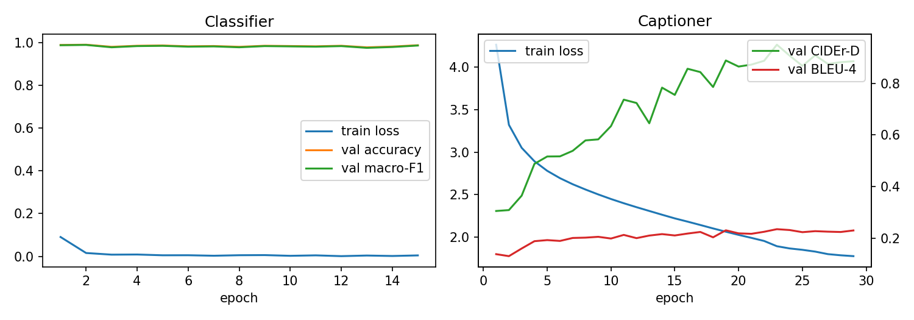

# 💎 Automated Caption Generation using Encoder Decoder Model for Jewellery Images


[](https://www.kaggle.com/datasets/chandanagalgali/jewellery-dataset)

**🔗 [Try the live demo](https://chandana-galgali.github.io/Automated-Caption-Generation-using-Encoder-Decoder-Model-for-Jewellery-Images/)**. The model runs directly in your browser; there's nothing to install.

Upload a photo of a piece of jewellery and the system **classifies** it (earring or necklace) and **writes a natural-language description** of it, covering metal, stones, shape and style. For example:

> *"A pair of gold earrings adorned with ruby and emerald gemstones, arranged in a floral pattern."* (a real output on the test set)

It is built on a **VGG-16 encoder with GRU decoders** (PyTorch), with a **React** frontend and a **FastAPI** backend.

B.Tech (Information Technology) final-year project, K. J. Somaiya College of Engineering, Somaiya Vidyavihar University (2025). The report, technical paper, poster and presentations are in [`project documents/`](project%20documents).

## 📊 Results

<!-- METRICS:START -->
_All numbers below were produced by `training/run_all.py` on 2026-11-21 (Tesla T4, seed 42). Test sets were not used for any training or model-selection decision._

#### Dataset

| Split | Earrings | Necklaces | Total | Used for |
|---|---|---|---|---|
| train | 2484 | 1301 | 3785 | training (+ 5 augmented views per image) |
| val | 532 | 279 | 811 | model selection / early stopping |
| test | 532 | 278 | 810 | final evaluation only |
| external | 23 | 30 | 53 | unseen web images, final evaluation only |

Splits are grouped so that duplicate photos and identical descriptions never appear in two splits.

#### Jewellery type classification (VGG-16 + GRU)

| Test set | Accuracy | Precision (macro) | Recall (macro) | F1 (macro) | ROC-AUC |
|---|---|---|---|---|---|
| Held-out test (n=810) | **98.64%** | 98.38% | 98.62% | 98.50% | 0.9986 |
| External web images (n=53) | **100.00%** | 100.00% | 100.00% | 100.00% | 1.0000 |

| Class (held-out test) | Precision | Recall | F1 | Support |
|---|---|---|---|---|
| Earring | 99.24% | 98.68% | 98.96% | 532 |
| Necklace | 97.51% | 98.56% | 98.03% | 278 |

Validation accuracy at the selected epoch (2): 99.01%. Confusion matrix: [confusion matrix](results/confusion_matrix.png).

#### Description generation

| Method | Test set | BLEU-1 | BLEU-2 | BLEU-3 | BLEU-4 | METEOR | ROUGE-L | CIDEr-D |
|---|---|---|---|---|---|---|---|---|
| VGG-16 + attention GRU (beam 3) | held-out | 0.5273 | 0.3728 | 0.2878 | **0.2273** | 0.4964 | 0.5154 | 0.8755 |
| VGG-16 + attention GRU (beam 3) | external web | 0.3334 | 0.1583 | 0.0909 | **0.0421** | 0.2477 | 0.3476 | 0.1669 |
| Nearest training description | held-out | 0.4978 | 0.3369 | 0.2470 | **0.1864** | 0.4601 | 0.4794 | 0.7103 |
| Nearest training description | external web | 0.2948 | 0.1470 | 0.0907 | **0.0482** | 0.2263 | 0.3174 | 0.2058 |

Captioner selected at epoch 23 by validation CIDEr-D. Default description mode in the app: **generate** (validation CIDEr-D: generated 1.0360, retrieved 0.7767).

#### Inference speed

End-to-end (classification + description) on CPU with 2 threads: median **352 ms**, 95th percentile 986 ms over 30 test images.

Training time: 7.2 min on Tesla T4.


<!-- METRICS:END -->

## 🏗️ How it works


1. **Encoder.** The image is resized to 224×224, ImageNet-normalised and passed once through a frozen, ImageNet-pretrained **VGG-16**, giving a 7×7×512 feature map (49 image regions).
2. **Classifier (VGG-16 → GRU).** A GRU (hidden size 256) reads the 49 region vectors as a sequence, and a linear layer predicts *Earring* or *Necklace*.
3. **Caption decoder (VGG-16 → attention GRU).** A GRU language model (embedding 256, hidden 512) with soft attention over the 49 regions ("Show, Attend and Tell") writes the description word by word, looking at the relevant part of the image at each step. Decoding uses beam search (k = 3).
4. **Retrieval baseline.** For comparison, the system can also return the description of the most similar training image, using cosine similarity of the same VGG-16 features. Generation scored higher on the validation set, so it is the default.

**Training setup**
- **Leakage-free splits.** The 70 / 15 / 15 train / validation / test split is grouped by photo, so duplicate photos and identical descriptions never appear in two splits.
- **Augmentation** (random crop, flip, rotation, colour jitter) is applied to training images only: 5 extra views per image.
- **Fast training.** The frozen VGG-16 features are computed once and cached, so training takes minutes on a single GPU.
- **Model selection.** The best epoch is chosen on the validation set (macro-F1 for the classifier, CIDEr-D for the captioner), and the test sets are used only for the final numbers.

## 📁 Dataset

**[Jewellery Dataset on Kaggle](https://www.kaggle.com/datasets/chandanagalgali/jewellery-dataset)**: 5,406 images (3,548 earrings and 1,858 necklaces) with descriptions and a fixed train / validation / test split, plus 53 external web images for testing.

The images come from open Hugging Face datasets (*AI Tool Pool Jewelry Vision*, `imnaveenk/necklace`, `Bhargav1127/necklace-dataset-with-captions`) and manually collected photos (jhumkas, natural backgrounds, worn by a person). Details are in [`dataset/README.md`](dataset/README.md).

```
jewellery-dataset/
├── images/            5,406 images (JPEG, longer side 512 px)
├── labels.csv         id, file, description, type, split (train/val/test), group, source
└── external_test/     53 web images + labels.csv
```

## 🚀 Getting started

### 1. Clone

```bash
git clone https://github.com/chandana-galgali/Automated-Caption-Generation-using-Encoder-Decoder-Model-for-Jewellery-Images.git
cd Automated-Caption-Generation-using-Encoder-Decoder-Model-for-Jewellery-Images
```

The trained weights are included in [`backend/weights/`](backend/weights), so the app works straight away.

### 2. Run the app

**Requirements:** Python 3.10+ and Node.js 18+.

```bash
# Backend: http://localhost:8000 (interactive API docs at /docs)
cd backend
python -m venv .venv
.venv\Scripts\activate             # Windows   (macOS/Linux: source .venv/bin/activate)
pip install -r requirements.txt
uvicorn main:app --reload --port 8000
```

```bash
# Frontend: http://localhost:3000 (new terminal)
cd frontend
npm install
npm start
```

Open http://localhost:3000, then upload a photo or click one of the sample images.

**With Docker** (frontend and backend in one container): `docker build -t jewellery-analyzer .`, then `docker run -p 8000:8000 jewellery-analyzer`, and open http://localhost:8000.

### 3. Use the API

```bash
curl -F "file=@test_images/1.jpeg" http://localhost:8000/analyze
```

The response contains `type`, `confidence`, `description`, `inference_ms` and `method`. Add `?mode=retrieve` to get the retrieval baseline's description instead.

### 4. Run the tests

```bash
cd backend && pip install pytest httpx && pytest -q     # API + model tests
cd frontend && npm test                                 # UI tests
```

The same tests, plus a small end-to-end training run on synthetic data, run on every push through [GitHub Actions](.github/workflows/ci.yml).

## 🧪 Train and evaluate it yourself

One script does everything: feature extraction, training both models, model selection on validation, and final evaluation on the test sets. It writes the weights, `metrics.json`, `METRICS.md`, plots and per-image predictions. It takes about **7 minutes on a free T4 GPU**.

**Option A: Kaggle (free GPU, easiest).** Import [`notebooks/04_kaggle_train_and_evaluate.ipynb`](notebooks/04_kaggle_train_and_evaluate.ipynb) into Kaggle. Add the [jewellery-dataset](https://www.kaggle.com/datasets/chandanagalgali/jewellery-dataset) as input, choose a GPU with Internet on, and click **Run All**.

**Option B: Google Colab (free GPU).** Download the dataset zip from Kaggle into your Google Drive, open [`notebooks/05_colab_train_and_evaluate.ipynb`](notebooks/05_colab_train_and_evaluate.ipynb), select a T4 GPU and click **Run all**.

**Option C: your own machine (GPU recommended).**

```bash
pip install -r training/requirements.txt          # plus PyTorch for your system: https://pytorch.org
kaggle datasets download -d chandanagalgali/jewellery-dataset --unzip -p data
python training/run_all.py --data data --out run
```

**Use your trained model in the app.** The following command copies the new weights into `backend/weights/` and the metrics and plots into `results/`, and refreshes the Results section of this README:

```bash
python training/install_results.py run.zip
```

**Metrics reported:**
- **Classification:** accuracy, precision, recall, F1 (per class and macro), ROC-AUC and the confusion matrix.
- **Descriptions:** BLEU-1 to BLEU-4, METEOR, ROUGE-L and CIDEr-D.
- **Speed:** CPU inference latency.

## 📂 Project structure

```
backend/                FastAPI app: API (main.py), models + inference (caption_model.py), trained weights, tests
frontend/               React + Tailwind web app (upload, drag & drop, sample images)
training/               run_all.py (train + evaluate), metrics.py, prepare_dataset.py, export_onnx.py, install_results.py
results/                Metrics, confusion matrix, training curves and test-set predictions of the current model
notebooks/              Original project notebooks + Kaggle / Colab training notebooks
dataset/                Label files and the 53-image external test set
project documents/      Report, technical paper, poster, presentations, architecture diagram, screenshots
experiments/            Earlier LLM (Gemini) baseline, not used by the app
test_images/            Sample images for trying the app
```

## ⚠️ Limitations and future work

- **Two classes only.** Rings, bracelets and other jewellery are forced into earring or necklace; the app flags low-confidence results.
- **Mostly product photos.** Most training images are product shots on plain backgrounds, so descriptions of photos taken in the wild are less accurate (see the external test results). More varied training photos would help.
- **Next steps:** add more jewellery types, fine-tune the upper VGG-16 layers, and try a transformer decoder.

## 🛠️ Tech stack

PyTorch · Torchvision · FastAPI · React · Tailwind CSS · ONNX Runtime Web · NumPy · Pillow · Matplotlib · Docker · GitHub Actions

## 👥 Team

Chandana Galgali · Tanisha Mangaonkar · Prachi Gandhi · Mahek Thakkar | Guide: Prof. Avani Sakhapara | Department of Information Technology | K. J. Somaiya College of Engineering

## 📄 License

[MIT](LICENSE)
